# Mobile offline-first sync (v2)

Scope: the Android app in `apps/mobile`. Status on 2026-10-20: implemented
and covered by Dart unit/widget tests (`flutter test`: 173 passing,
`flutter analyze`: no issues). It has **not** run on a device yet (no
Android SDK in the development container — see `ANDROID_BUILD.md`).

## 1. What may happen offline, and what may not

The rule: offline work is a **draft or a request**. Nothing offline skips
the server's authorisation, clinical validation or financial controls,
because nothing offline is final — every queued change is re-checked by the
API when it syncs.

| Allowed offline (queued or kept on the device) | Why it is safe |
|---|---|
| Patient registration | server duplicate check runs at sync; a match becomes a **Conflict** |
| Cached patient lookup | only patients this user already fetched online; encrypted; ≤ 1,000; 7-day TTL; wiped on sign-out / revocation |
| Appointment drafts | server checks the slot at sync (409 → Conflict) |
| OPD queue check-in requests (manual or QR) | per-day dedupe key + Idempotency-Key |
| Consultation note drafts (`POST /encounters`) | editable on the device only until first sent |
| Prescription **drafts** | the server's allergy check and `prescription.sign` gate run at signing |
| Billing **drafts** (invoices) | the server computes totals and numbers |
| Inventory count drafts | kept on the device only; never auto-synced |

| Online only, server-verified | UI offline |
|---|---|
| Signing a prescription | disabled + "Needs connection — will not be finalised offline" |
| Confirming a payment (new Idempotency-Key per confirmation) | same |
| Completing a consultation | same |
| Posting a stock adjustment from a count (re-reads quantity on hand first) | same |
| Printing a signed Rx / a receipt (built only from server data) | same |
| Refunds, discharge, lab result release | not offered in the mobile app |
| Reports ("Today's summary", Overview) | "Needs connection" panel; nothing cached |

## 2. Record state machine

```mermaid
stateDiagram-v2
    [*] --> SavedOnDevice: enqueue (client UUID = Idempotency-Key)
    SavedOnDevice --> PendingSync: device online
    PendingSync --> Syncing: run picks it (parents synced)
    PendingSync --> PendingSync: parent not synced yet (waits)
    PendingSync --> ActionRequired: parent is Conflict / Action required (blocked)\nor parent discarded (orphaned)
    Syncing --> Synced: 2xx (server id recorded; $ref children rewritten)
    Syncing --> PendingSync: network error / 408 / 429 / 5xx\n(backoff 2 s…15 min, full jitter, Retry-After floor)
    Syncing --> Conflict: 409 / 412 (version mismatch, duplicate patient)
    Syncing --> ActionRequired: other 4xx (refused), wrong user,\nor 10th transient failure (max attempts)
    Syncing --> PendingSync: app killed mid-push → restart\n(same key, payload frozen)
    Conflict --> PendingSync: user — keep mine (new key, confirmed)
    Conflict --> Synced: user — use server record (dependants re-pointed)
    Conflict --> [*]: user — discard (dependants listed first)
    ActionRequired --> PendingSync: user — Retry now
    ActionRequired --> [*]: user — discard
    Synced --> [*]
```

Global status (app bar, precedence): Syncing › Conflict › Action required ›
Offline › Pending sync › Synced (last run clean) › Online. All eight labels
exist in English, मराठी and हिंदी (`statusOnline` … `statusActionRequired`).

## 3. Engine rules (`lib/sync/`)

* **Idempotency** — every op id is a `Random.secure` UUID v4 sent as
  `Idempotency-Key` on every attempt and after every restart; only an
  explicit user re-send (register anyway / send mine again) gets a new key.
* **Dependency ordering** (`planner.dart`) — parents are the ops creating
  the `$ref:<local>` values found in an op's path, payload or explicit
  `dependsOn`. A run is sorted topologically (stable otherwise); children
  push in the same run right after their parent with the server id
  substituted. Waiting / blocked / orphaned as in the diagram.
* **Backoff** — 2 s × 2ⁿ⁻¹ capped at 15 min, random in [d/2, d];
  `Retry-After` honoured. After `Outbox.maxAttempts` (10) the op stops
  retrying by itself (no radio wake-ups) → Action required; "Retry now"
  restores a fresh budget with the same key.
* **Poison isolation** — 4xx/5xx on one op never stops unrelated ops; three
  5xx answers in a row end the run (server unwell); a network exception
  ends the run (every op would wait for the same timeout).
* **No concurrent double-send** — one run at a time (callers share it) and
  a per-op in-flight guard.
* **Crash recovery** — `inFlight` ops go back to pending with
  `everSent = true` (payload frozen, same key). Ops for endpoints without
  server idempotency (appointments, encounters) persist the in-flight mark
  before the request.
* **Persistence** — the run batches outbox notifications and checkpoints
  every 25 accepted ops; anything a *person* does (enqueue, resolve,
  discard) is persisted immediately even during a run.
* **Wrong user** — an op is never pushed under another user's session.
* **Network awareness** (`network.dart`) — reachability is learnt from the
  requests the app makes anyway (no polling). Offline → online triggers one
  forced run. Metered hook: `NetworkMonitor.setMetered(true)` (platform
  adapter not bundled) defers ops whose body > 16 KB.
* **Scheduling** — sync on enqueue, app resume/unlock, sign-in,
  connectivity regain and manual; otherwise one timer for the earliest
  backoff retry, none when the queue is empty.

## 4. Conflict policy — never last-write-wins

| Conflict | Choices (all explicit, all confirmed) |
|---|---|
| Duplicate patient (409 + candidates, kept with the op across restarts) | **Keep mine as a new patient** (`allow_duplicates: true`, new key) · **Use this record** (registration never sent; local ref mapped to the existing patient so the queued visit/Rx/bill go there) · **Merge by review** (online: server record re-read, nothing pre-ticked, only ticked fields sent with `PATCH /patients/{id}`) · Discard (dependants listed) |
| Version mismatch 409/412 | side-by-side view; **Send mine again** (new key; the server re-checks) · **Use the server version** (discard mine) |
| Refused (403/422) / max attempts | Retry now · Discard |
| Created by another user | never sent; legacy ops without a creator can be claimed |
| Orphaned (parent discarded) | Discard |

## 5. Multi-device and device revocation

Uses the existing session API unchanged. Detection (`auth/revocation.dart`):
an authenticated call answered `401 "Session is no longer valid"` /
`"Account is not active"` followed by a refused refresh, or a refresh
answered `403 "Membership is not active"` / `"Organization is not active"`.
A plain expiry (`"Invalid or expired token"` then refused refresh) keeps the
M7.0 behaviour: banner, offline work continues, sign in again.

On revocation the app: halts the engine and scheduler; **moves** every
unsynced item (outbox ops with their keys, offline registrations, unsynced
Rx / consultation / appointment drafts, unposted stock counts) into a sealed
`quarantine` section; wipes the cached patients, drug list, synced drafts,
tokens, profile and PIN; returns to sign-in with "This device was signed
out by an administrator".

**Decision.** The quarantine lives inside the same AES-256-GCM store
(Keystore key), so it is encrypted at rest exactly like before, and it is
unreachable from every screen. It is released only when the **same user
id in the same organisation** signs in online again; ops then resume with
their original Idempotency-Keys, so nothing is applied twice. Anyone else
sees only a count and may explicitly discard it after their own online
sign-in. Sign-out by another user does not delete it (not theirs);
"Reset local data" on the recovery screen does. We did not add a second,
server-escrowed key for the quarantine (that needs an API change — see §8);
the residual risk is a rooted device with the Keystore extracted, which
already exposes the whole store. Edge case: if the refresh session reaches
its absolute cap while an access token is still valid, the device takes the
revocation path (fail-safe: PHI wiped, drafts kept).

## 6. Storage, encryption, low-cost phones

* One JSON document sealed with AES-256-GCM (`EncryptedFileStore`), key in
  Android Keystore via `flutter_secure_storage`; backups disabled.
* Bounded: ≤ 1,000 cached server patients (7-day TTL), ≤ 50 synced drafts
  per draft list, ≤ 2,000 count drafts, server snapshots ≤ 8 KB per op.
* Sync centre shows the encrypted size, cached patient count, and
  **Clear cached patient data** (keeps unsynced registrations).
* Lazy UI: `ListView.builder` / `SliverList.builder` for patients and the
  queue list; tabs are built on first visit; the global status bar
  rebuilds alone; system fonts; no images; PDFs use the built-in Helvetica
  (no font asset).

## 7. Role interfaces

From `/auth/me` `role` (+ `permissions` when reported; stored for offline
start): Doctor → Queue · Consult · Rx · Patients · Sync; Reception / nurse /
billing → Queue · Register · Appointments · Billing · Sync; Owner / admin →
Overview (today's collections, refunds, net, appointments, admitted, low
stock + this device's sync health) · Queue · Register · Rx · Billing · Sync;
Pharmacist → Stock · Patients · Sync; Rural Clinic mode (any role) →
Register · Queue · Fast Rx · Bill. Features still gate tabs; QR check-in is
opt-in (`qr_checkin`).

## 8. API changes requested (not made here)

1. **`POST /api/v1/opd/check-in`** (check-in workstream). Body
   `{"token": "<opaque>", "branch_id": "<uuid|null>"}`, header
   `Idempotency-Key`; 201 `QueueEntryOut`; **200** `QueueEntryOut` when the
   patient is already checked in today (not 409, so a replay is not a
   conflict); 404 unknown, 410 expired; `queue.manage`; audited. Report
   `qr_checkin` in `/auth/me` `features` when available.
2. **Idempotency-Key on `POST /appointments` and `POST /encounters`** (same
   semantics as `/patients`): today a replay after a crash mid-push can
   create a duplicate appointment or hit "Patient already has an open
   encounter".
3. **Optimistic concurrency on `PATCH /patients/{id}`** (`version` or
   `If-Match`), answering 409/412 on mismatch — merge-by-review currently
   re-reads the record immediately before sending, which narrows but does
   not close the window.
4. Optional: a distinct 401 detail for an expired vs revoked refresh
   session (e.g. `"Session revoked"`) to remove the ambiguity in §5.

## 9. Test evidence

`cd apps/mobile && flutter analyze && flutter test` — 173 tests, all
passing (121 pre-existing, 52 new). New suites:

* `test/smart_sync_test.dart` — topological order with id rewrite in
  payload **and path**, blocked children (not attempted) and unblocking,
  waiting vs blocked, orphaned, same key on every retry, backoff bounds,
  max attempts → Action required, poison isolation (5xx and 422), 5xx
  circuit, crash recovery with frozen payload, in-place edit of never-sent
  drafts, concurrent `sync()` sends each op once, halt/resume, metered
  deferral, reachability + regain, **5,000 ops in one run** (< 20 s, < 210
  persistence notifications).
* `test/revocation_and_roles_test.dart` — status per record and global
  precedence; revoked vs expired classification; client → revoked;
  expiry keeps data; full revocation wipe + quarantine + same-user release
  with the same keys; other user cannot release, may discard; home shell →
  sign-in with the administrator notice; role tab sets and permission
  gating; receptionist appointments draft; admin overview online and
  "Needs connection" offline.
* `test/dashboard_and_screens_test.dart` — dashboard counts + per-item
  Retry now; max-attempts card; **2,000-item lazy list**; duplicate →
  "Use this record" re-points the queued visit; merge-by-review sends only
  ticked fields; version mismatch side-by-side + new key; offline guard on
  Rx Sign and `OnlineOnlyButton`; consultation draft offline + in-place
  edit; patients tab with **2,000 patients** builds < 40 rows; cache
  bound/TTL/clear; storage usage; GS1 and check-in token parsing; QR
  check-in via fake scanner (dedupe, invalid code, opt-in gate); stock
  count from a scanned GS1 pack; PDFs (watermark words on the page,
  signed Rx only from a signed server record, receipt only from a server
  invoice, Latin-1 safety); status labels in en/mr/hi.
